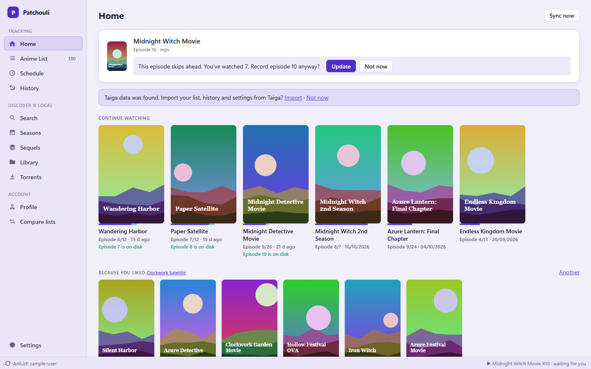
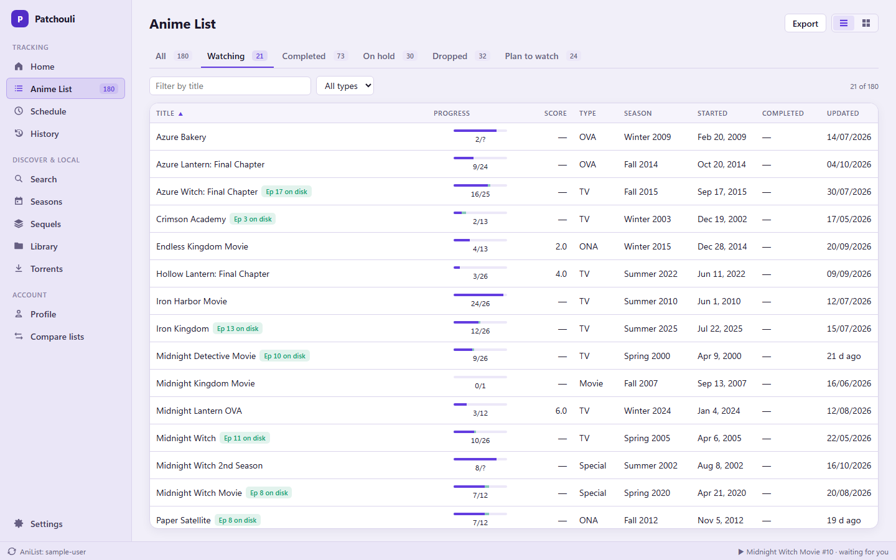
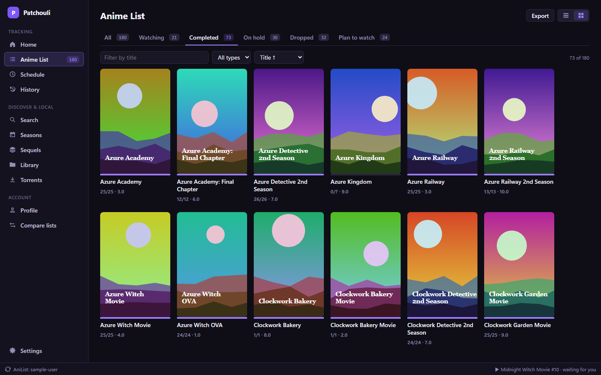
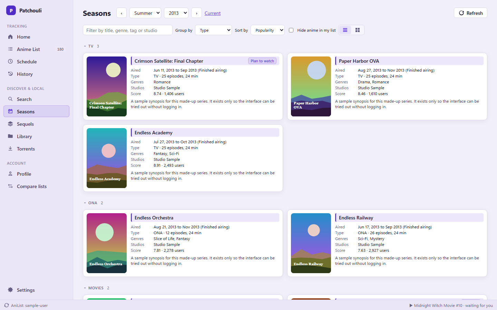

# Patchouli

Patchouli keeps your AniList or MyAnimeList list up to date while you watch. Play an episode in mpv, VLC, MPC-HC or most other players, and it works out which show and episode that is. A couple of minutes in, it marks the episode as watched.

It's a rewrite of [Taiga](https://github.com/erengy/taiga) in Rust and Tauri, and it can bring over your Taiga list and settings.

## Getting it

Download the installer or the portable ZIP from [Releases](https://github.com/oguzaliarslan/patchouli/releases). If there's nothing there yet, [build it yourself](docs/development.md).

Once it's running:

1. Log in under Settings › Accounts. If it says the build has no client ID, [set one up](docs/setup.md#logging-in).
2. Add the folders your anime is in under Settings › Library.
3. Play an episode. Home shows what Patchouli recognised and how long until it updates your list.

Used Taiga before? Patchouli offers to import it the first time you open it, or you can do it later from Settings › Advanced › Import from Taiga. You'll have to log in again afterwards.

Windows is the only platform it's been tested on. Linux and macOS builds can detect some players, but nobody has tried them yet.

## Your list

The list has a table view and a poster view, one tab per status, and a filter. Next to each title you can see when the next episode airs, or that it's already in your folders.

Ctrl+click or Shift+click to select several anime, then right-click to change their status or score in one go. You can choose what double-click and middle-click do in Settings › Application. The list exports as Markdown or MyAnimeList XML.

## Seasons

Every anime of a season, grouped by type, airing status or whether it's in your list. Click a group's header to fold it. You can sort by popularity, score or start date, and filter by title, genre or studio.

## Also

- Schedule shows when the next episode of each show you're watching airs, and you can get a notification when it does.
- Sequels finds new seasons of things you've finished, and Home suggests more based on what you liked.
- If you have both an AniList and a MyAnimeList account, changes can be copied from one to the other. Compare lists shows where they've drifted apart.
- Torrents checks an RSS feed for new episodes of what you're watching, using Taiga's filters.
- It can show what you're watching on Discord, or send it to a webhook.
- Profile has your stats and a heatmap of the year.
- Ctrl+K jumps to any page or anime. Ctrl+Alt+Shift+Up marks the next episode of what's playing as watched from anywhere, and Ctrl+Alt+Shift+P pauses detection.

The screenshots use the made-up sample data from the browser preview, so the titles and posters aren't real.

## More

- [Setup](docs/setup.md): logins, Discord, importing from Taiga, players, where your data lives
- [Development](docs/development.md): building and running from source
- [Releases](docs/releases.md): packaging, signing and updates
- [Migration notes](MIGRATION_PLAN.md): how the Taiga port was done and what's still missing

Patchouli is GPLv3, like Taiga. See [LICENSE](LICENSE) and [THIRD_PARTY.md](THIRD_PARTY.md).
